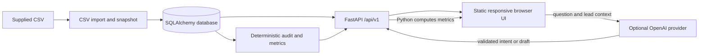

# BIAI DealFlow

BIAI DealFlow is a local demo MVP for the Corporate Leads Pipeline task. It loads the supplied fictional lead CSV into SQLite, keeps each original imported row for audit, and serves the browser app and versioned API from one FastAPI service.

## Features

- A live dashboard with total leads, active pipeline value, Proposal value, overdue count, flagged rows, and Paid deals.
- A seven-stage pipeline board and searchable lead table with stage, owner, industry, overdue, issue, and sort filters.
- Editable lead fields and stage changes saved to SQLite; every edit records a small activity entry.
- A data quality center with source values, severity, explanations, proposed review actions, resolution status, and CSV export.
- Duplicate review that groups exact normalized company names and the sample's repeated Meghna contact/deal details. It flags records without silently merging or deleting them.
- English follow-up draft generation from the selected lead's actual notes. With `OPENAI_API_KEY`, the server can use OpenAI Responses; otherwise it clearly labels and returns the deterministic demo template.
- A pipeline question box. Without a key, supported questions use deterministic local parsing. With OpenAI configured, the model extracts a validated intent and stage, and Python computes the answer from saved rows. Model output is never used for arithmetic or SQL.
- CSV and audit CSV exports, and a CSV upload preview that validates headers without replacing the original sample.

## Run locally (Windows PowerShell)

From the project root:

```powershell
py -m venv .venv
.\.venv\Scripts\Activate.ps1
pip install -r backend\requirements.txt
Copy-Item .env.example .env
uvicorn backend.app.main:app --env-file .env --reload --host 127.0.0.1 --port 8000
```

Open [http://127.0.0.1:8000](http://127.0.0.1:8000). On first startup, the app imports the supplied 25-row CSV and runs the audit. The default database is `backend/dealflow.db`. Keep that file to retain edits; remove it to reset to the supplied source data. Do not commit the generated database.

The API documentation is at `/docs`. Health is at `/api/v1/health`.

## Environment

See `.env.example`. `DATABASE_URL` defaults to local SQLite. For PostgreSQL, use a SQLAlchemy PostgreSQL URL and install the included `psycopg[binary]` driver. `APP_TIMEZONE` defaults to `Asia/Dhaka`; overdue is calculated at request time using that timezone. `OPENAI_API_KEY` is optional and is read only by the backend. `AI_PROVIDER=openai` enables the optional provider; missing credentials or provider errors fall back to demo mode.

## API overview

- `GET /api/v1/leads`, `GET /api/v1/leads/{id}`, `PATCH /api/v1/leads/{id}`
- `GET /api/v1/dashboard/summary`, `/pipeline`, `/follow-ups`
- `GET /api/v1/data-quality/issues`, `POST /api/v1/data-quality/audit`, issue resolution, duplicate review listing
- `POST /api/v1/ai/follow-up-email`, `POST /api/v1/ai/query`, `GET /api/v1/ai/priorities`
- `POST /api/v1/import/csv` (safe preview), `GET /api/v1/export/csv`, `GET /api/v1/export/data-quality`

## Audit of the supplied sample

The audit uses the original rows, not an already-cleaned subset. **9 of 25 source rows are flagged** for human review. Findings include:

- Duplicate group 1: L01 and L23, exact normalized company and contact match.
- Duplicate group 2: L02 and L03, different company-name variants but matching contact, email, phone, stage, and value. The records remain separate pending confirmation.
- Missing fields: L06 has no phone; L24 has no contact name or email.
- Source inconsistency: L06 notes say no phone or email is on file, while an email is populated.
- Stage/notes mismatch: L12 says Paid although its note says only a 50% advance arrived and a second payment is due. Paid means full amount received in the supplied stage definitions.
- Possible email typo: L18 notes explicitly ask to check the unusual email spelling. The app does not guess a correction.
- Date-order error: L25 has next follow-up 21 Oct 2026 before last contact 28 Oct 2026. The app preserves both values and suggests review; it does not invent a replacement date.

The dashboard's flagged-row count is distinct by original lead ID, while the issue table may show several findings for one row. Overdue status excludes Paid and Lost and uses today's date in Asia/Dhaka. At the supplied reference date of 1 Nov 2026, L09's follow-up is due today, not overdue; running on 2 Nov 2026 makes it overdue.

### Data dictionary and validation

See [`docs/data_dictionary.md`](docs/data_dictionary.md) and [`docs/data_quality_report.md`](docs/data_quality_report.md) for field mapping and issue-level detail.

## Architecture



The frontend is plain HTML, CSS, and JavaScript to keep this small demo easy to run without a Node build step. The API and data layer use FastAPI, Pydantic, and SQLAlchemy. The model is limited to writing email copy or extracting a structured question intent. Dates, validation, totals, overdue status, and prioritization are deterministic backend logic.

The priority endpoint ranks active leads with a transparent score: 5 points per overdue day (capped at 50), 3 points per BDT 100,000 of deal value (capped at 25), 10 points when no follow-up date exists, and 2 points per later active stage. This is a review aid, not a prediction.

## Tests

Run the included standard-library test suite:

```powershell
python -m unittest discover -s backend/tests -v
```

The suite covers the supplied duplicate pairs, company normalization, the original-row flag count, Proposal calculation, terminal-stage overdue exclusion, editable lead API, note-based draft fallback, static app response, and CSV export. The frontend inline JavaScript is syntax-checked with Node during development.

## Deploy a public demo on Render

The included `render.yaml` defines one web service for the UI and API and a PostgreSQL database. To publish it:

1. Push this project to a GitHub repository. The `.gitignore` excludes `.env`, `.myvenv`, and the local SQLite database; do not force-add those files.
2. In Render, choose **New → Blueprint**, connect that GitHub repository, and apply the Blueprint. Render reads `render.yaml`, builds the Python service, and provisions the database.
3. Wait for the first deploy, then open the `onrender.com` URL from the service page. Check `/api/v1/health` and the homepage.
4. For live email drafting and AI intent extraction, add `OPENAI_API_KEY` in the service's Environment settings. Without it, the app works in clearly labeled demo mode.

Render's free web service can sleep after inactivity, and a free Render Postgres database expires after 30 days. That's suitable for a short demo; keep a paid database or another persistent PostgreSQL database for a link and data that must remain available longer. Render's web service must bind to `0.0.0.0`; the Blueprint start command already does this. The UI is served by FastAPI, so no separate Vercel site or CORS setup is needed.

## Deploy on Vercel as two services

The Vercel Services config deploys the static frontend and FastAPI backend independently under one Vercel project and domain:

- `biai-dealflow` serves `frontend/` publicly at `/`.
- `backend` runs `backend.app.main:app` and receives public `/api/*` requests.

The browser calls the backend through same-origin `/api/v1/...` paths, so the routing rewrite connects the two services and no service binding is needed. The backend requires a persistent PostgreSQL `DATABASE_URL`; local SQLite is only for development.

1. Push the project to GitHub and import that repository in Vercel.
2. Keep the repository root as the project root. Vercel uses [`vercel.json`](vercel.json) to build both services and route requests.
3. Connect PostgreSQL through Vercel Marketplace (such as Neon or Supabase) and set `DATABASE_URL` for Production.
4. Optionally set `OPENAI_API_KEY`. Without it, the backend uses deterministic demo mode.
5. Deploy, then open the project URL and check `/api/v1/health` and `/api/v1/leads`.

Vercel supports FastAPI services and a separate static service in one project. The root `requirements.txt`, Python version pin, FastAPI entrypoint, and CSV bundle rule are included. See the [Vercel Services guide](https://vercel.com/docs/services), [FastAPI deployment guide](https://vercel.com/docs/frameworks/backend/fastapi), and [Marketplace storage](https://vercel.com/docs/marketplace-storage).

## Known limitations

- The CSV import endpoint previews an upload but does not replace or append to the active dataset; this avoids accidental loss of the original sample.
- The current demo supports editing existing leads; lead creation and deletion are not exposed in the interface.
- Issue resolution is stored and preserved across re-audits when the same finding remains; fixing the underlying record removes the finding on the next audit.
- Duplicate review lists groups and reasons but does not merge them. This preserves history until a person confirms the correct canonical record.
- The activity table logs edits, but the UI does not yet show a full activity timeline.
- The app has no authentication, role permissions, migrations, or automated frontend interaction suite. Use PostgreSQL and add those controls before real customer use.
- OpenAI integration is optional and has not been exercised without a configured API key; demo mode is fully offline.

## Five-minute Loom outline

1. (0:00–0:35) Explain lost follow-ups and show the 25-row sample workspace.
2. (0:35–1:20) Walk through the seven stages and the KPI cards.
3. (1:20–2:10) Filter overdue leads and open one record; show its notes and editable fields.
4. (2:10–2:50) Generate the note-based English follow-up draft and point out demo/live mode.
5. (2:50–3:40) Ask “What is the total value in Proposal stage?” and explain deterministic calculation.
6. (3:40–4:35) Review the two duplicate groups, L25's date-order error, L12's partial-payment stage mismatch, and the other flagged rows.
7. (4:35–5:00) Export the pipeline and audit report; finish with limitations and next steps.
